# Entités géographiques : implémentation en RDF

Cette page décrit l'implémentation en RDF du modlet `Entités géographiques` de l'ontologie TABULAE. 

Ce modlet est une extension du modlet ```Adresses``` de l'ontologie PeGazUs. Veuillez vous reporter à cette ontologie pour obtenir plus les détails.

## Diagramme de classes (TBox)

```mermaid
classDiagram
    direction TB

    %% 1. Repère géographique, version de repère et type (PeGazUs)
    class Landmark["peg:Landmark"] {
        dcterms:identifier : xsd:string
        rdfs:label : xsd:string
    }
    class LandmarkType["peg:LandmarkType"]
    class Concept["skos:Concept"]
    class Plot["tblltype:Plot"]
    <<SKOSConcept>> Plot

    %% 2. Patron attribut / version d'attribut (PeGazUs)
    class Attribute["peg:Attribute"]
    class AttributeType["peg:AttributeType"]
    class AttributeVersion["peg:AttributeVersion"] {
        peg:versionValue : rdfs:Literal
    }

    class PlotTaxpayer["tblatype:PlotTaxpayer"]
    <<SKOSConcept>> PlotTaxpayer
    class PlotNature["tblatype:PlotNature"]
    <<SKOSConcept>> PlotNature
    class PlotAddress["tblatype:PlotAddress"]
    <<SKOSConcept>> PlotAddress
    class PlotMention["tblatype:PlotMention"]
    <<SKOSConcept>> PlotMention

    %% 3. Relations entre repères et adresses (PeGazUs)
    class LandmarkRelation["peg:LandmarkRelation"]
    class LandmarkRelationType["peg:LandmarkRelationType"]
    class Address["peg:Address"]

    %% 4. Classes des valeurs (TABULAE, RiC-O)
    class Taxpayer["tbl:Taxpayer"]
    class Nature["tbl:Nature"]
    class RecordResource["rico:RecordResource"]
    class Instantiation["rico:Instantiation"]
    class SpecialCellValue["tbl:SpecialCellValue"]

    %% 6. Hiérarchie SKOS des types (PeGazUs)
    Concept <|-- LandmarkType
    Concept <|-- AttributeType
    Concept <|-- LandmarkRelationType

    %% 7. Repère et attributs
    Landmark --> LandmarkType : <span style='background-color#58;#DCE8F7'>peg#58;isLandmarkType</span>
    Plot ..> LandmarkType : rdf#58;type

    Landmark --> Attribute : <span style='background-color#58;#DCE8F7'>peg#58;hasAttribute</span>
    Attribute --> AttributeType : <span style='background-color#58;#DCE8F7'>peg#58;isAttributeType</span>
    Attribute --> AttributeVersion : <span style='background-color#58;#DCE8F7'>peg#58;hasAttributeVersion</span>

    PlotTaxpayer ..> AttributeType : rdf#58;type
    PlotNature ..> AttributeType : rdf#58;type
    PlotAddress ..> AttributeType : rdf#58;type
    PlotMention ..> AttributeType : rdf#58;type

    %% 8. Propriétés de valeur TABULAE (un range en owl:unionOf = une flèche par classe membre)
    AttributeVersion --> Taxpayer : <span style='background-color#58;#5CB85C'>tbl#58;hasTaxpayer</span>
    AttributeVersion --> Nature : <span style='background-color#58;#5CB85C'>tbl#58;hasPlotNature</span>

    AttributeVersion --> Address : <span style='background-color#58;#5CB85C'>tbl#58;hasPlotAddress</span>
    AttributeVersion --> LandmarkRelation : <span style='background-color#58;#5CB85C'>tbl#58;hasPlotAddress</span>
    AttributeVersion --> Landmark : <span style='background-color#58;#5CB85C'>tbl#58;hasPlotAddress</span>

    AttributeVersion --> RecordResource : <span style='background-color#58;#5CB85C'>tbl#58;isMentionnedIn</span> / <span style='background-color#58;#5CB85C'>tbl#58;takenFrom</span> / <span style='background-color#58;#5CB85C'>tbl#58;passedTo</span>
    AttributeVersion --> Instantiation : <span style='background-color#58;#5CB85C'>tbl#58;isMentionnedIn</span> / <span style='background-color#58;#5CB85C'>tbl#58;takenFrom</span> / <span style='background-color#58;#5CB85C'>tbl#58;passedTo</span>
    AttributeVersion --> SpecialCellValue : <span style='background-color#58;#5CB85C'>tbl#58;takenFrom</span> / <span style='background-color#58;#5CB85C'>tbl#58;passedTo</span>

    %% 9. Relations entre repères (la relation pointe vers les repères)
    LandmarkRelation --> Landmark : <span style='background-color#58;#DCE8F7'>peg#58;locatum</span> / <span style='background-color#58;#DCE8F7'>peg#58;relatum</span>
    LandmarkRelation --> LandmarkRelationType : <span style='background-color#58;#DCE8F7'>peg#58;isLandmarkRelationType</span>

    %% 10. Structure d'une adresse
    Address --> "1" Landmark : <span style='background-color#58;#DCE8F7'>peg#58;targets</span>
    LandmarkRelation <|-- AddressSegment

    %% 11. Styles par ontologie (palette : ../styles_mermaid.md)
    %% use-style tbl: Taxpayer, Nature, SpecialCellValue
    %% use-style tblConcept: Plot, PlotTaxpayer, PlotNature, PlotAddress, PlotMention
    %% use-style peg: Landmark, LandmarkVersion, LandmarkType, Attribute, AttributeType, AttributeVersion, LandmarkRelation, LandmarkRelationType, Address, AddressSegment, FinalAddressSegment
    %% use-style skos: Concept
    %% use-style rico: RecordResource, Instantiation
    %% style-labels
    %% sync:styles:start
    %% Généré par scripts/tools/sync_mermaid_styles.py : ne pas modifier à la main
    style Taxpayer fill:#5CB85C,stroke:#1E5E20,stroke-width:3px,color:#000
    style Nature fill:#5CB85C,stroke:#1E5E20,stroke-width:3px,color:#000
    style SpecialCellValue fill:#5CB85C,stroke:#1E5E20,stroke-width:3px,color:#000
    style Plot fill:#CDEBC5,stroke:#1E5E20,stroke-width:2px,stroke-dasharray:5 3,color:#000
    style PlotTaxpayer fill:#CDEBC5,stroke:#1E5E20,stroke-width:2px,stroke-dasharray:5 3,color:#000
    style PlotNature fill:#CDEBC5,stroke:#1E5E20,stroke-width:2px,stroke-dasharray:5 3,color:#000
    style PlotAddress fill:#CDEBC5,stroke:#1E5E20,stroke-width:2px,stroke-dasharray:5 3,color:#000
    style PlotMention fill:#CDEBC5,stroke:#1E5E20,stroke-width:2px,stroke-dasharray:5 3,color:#000
    style Landmark fill:#DCE8F7,stroke:#3366CC,stroke-width:1px,color:#000
    style LandmarkVersion fill:#DCE8F7,stroke:#3366CC,stroke-width:1px,color:#000
    style LandmarkType fill:#DCE8F7,stroke:#3366CC,stroke-width:1px,color:#000
    style Attribute fill:#DCE8F7,stroke:#3366CC,stroke-width:1px,color:#000
    style AttributeType fill:#DCE8F7,stroke:#3366CC,stroke-width:1px,color:#000
    style AttributeVersion fill:#DCE8F7,stroke:#3366CC,stroke-width:1px,color:#000
    style LandmarkRelation fill:#DCE8F7,stroke:#3366CC,stroke-width:1px,color:#000
    style LandmarkRelationType fill:#DCE8F7,stroke:#3366CC,stroke-width:1px,color:#000
    style Address fill:#DCE8F7,stroke:#3366CC,stroke-width:1px,color:#000
    style AddressSegment fill:#DCE8F7,stroke:#3366CC,stroke-width:1px,color:#000
    style FinalAddressSegment fill:#DCE8F7,stroke:#3366CC,stroke-width:1px,color:#000
    style Concept fill:#FCD9B0,stroke:#B5520B,stroke-width:1px,color:#000
    style RecordResource fill:#ECE3F5,stroke:#7A4E9C,stroke-width:1px,color:#000
    style Instantiation fill:#ECE3F5,stroke:#7A4E9C,stroke-width:1px,color:#000
    %% sync:styles:end
```



#### Correspondance entre types d'attributs et propriétés de valeur
Un ```peg:Attribute``` d'une parcelle a pour type (```peg:isAttributeType```) l'un des concepts ci-dessous ; ses versions (```peg:AttributeVersion```) portent alors la propriété de valeur correspondante.

| Type d'attribut (```peg:isAttributeType```) | Propriété(s) de la version d'attribut | Classe de la valeur |
|---|---|---|
| ```tblatype:PlotTaxpayer``` | ```tbl:hasTaxpayer``` | ```tbl:Taxpayer``` |
| ```tblatype:PlotNature``` | ```tbl:hasPlotNature``` | ```tbl:Nature``` |
| ```tblatype:PlotAddress``` | ```tbl:hasPlotAddress``` | ```peg:Address``` ∪ ```peg:LandmarkRelation``` ∪ ```peg:Landmark``` |
| ```tblatype:PlotMention``` | ```tbl:isMentionnedIn``` | ```rico:RecordResource``` ∪ ```rico:Instantiation``` |
| ```tblatype:PlotMention``` | ```tbl:takenFrom```, ```tbl:passedTo``` | ```rico:RecordResource``` ∪ ```rico:Instantiation``` ∪ ```tbl:SpecialCellValue``` |

#### Compléments issus de PeGazUs
* ```peg:LandmarkType```, ```peg:AttributeType``` et ```peg:LandmarkRelationType``` sont des sous-classes de ```skos:Concept``` : les types de repères, d'attributs et de relations sont donc des concepts SKOS, et non des sous-classes OWL.
* ```peg:hasAttribute``` a pour domaine ```owl:Thing``` : tout repère (et toute relation entre repères) peut porter des attributs.
* ```peg:versionValue``` porte la valeur littérale d'une version d'attribut lorsqu'elle n'est pas une ressource (par exemple une géométrie en ```geo:wktLiteral```). Elle n'a pas de range dans PeGazUs.
* Une ```peg:LandmarkRelation``` pointe vers les repères qu'elle relie : ```peg:locatum``` désigne le repère localisé, ```peg:relatum``` le repère de référence.
* Une ```peg:Address``` vise exactement un repère (```peg:targets```) et commence par exactement un segment (```peg:firstStep```, sous-propriété de ```peg:hasStep```, transitive). Un ```peg:AddressSegment``` est une relation entre repères avec exactement un ```peg:locatum``` et au moins un ```peg:relatum```. Le dernier segment est un ```peg:FinalAddressSegment```, sans ```peg:nextStep```.
* Inverses déclarés : ```peg:isAttributeOf``` (de ```peg:hasAttribute```), ```peg:isAttributeVersionOf``` (de ```peg:hasAttributeVersion```), ```peg:isStepOf``` (de ```peg:hasStep```).
* Hors du périmètre de ce schéma : la temporalité des versions (```peg:hasTime```, ```peg:hasNextVersion```, …) et les changements (```peg:Change```, ```peg:AttributeChange```, …) sont traités dans le modelet « Évolution temporelle ».

### Remarques
* ```rdfs:label``` peut être utilisé pour renseigner un label complet, lisible de la parcelle, comprenant l'identifiant de la parcelle, de la section et le nom de la commune (ex : C-119, Section C, Marolles-en-Brie).
* ```dcterms:identifier``` est utilisé pour fournir l'identifiant complet de la parcelle (ex : C-119). 
* De nombreuses instances de la classe ```tbl:Nature``` sont définies dans le schémas de concepts SKOS ```tbl:NatureList```.
* De nombreuses instances de la classe ```tbl:SpecialCellValue``` sont définies dans le schéma de concepts SKOS ```tbl:SpecialCellValuesList```.
* L'attribut ```tblatype:PlotMention``` est lié au modelet "Fonctionnement des documents cadatsraux". Il permet (1) de représenter les valeurs spéciales que l'on trouve dans les colonnes "Tiré de" et "Porté à" (reports de folios et indications de construction, destruction de bâtiments ou encore de réévaluations de parcelles).

## ABox

Voir `examples_entitesgeo.ttl`.

## Mémo
Les diagrammes ci-dessous représentent schématiquement l'implémentation d'éléments de l'ontologie.

### Représentation d'une parcelle

### Relations spatiales entre les entités géographiques cadastrales

```mermaid
graph
    PlotTypeNode(("tblltype:Plot<br><small>a peg:LandmarkType</small>"))
    SectionTypeNode(("tblltype:Section<br><small>a peg:LandmarkType</small>"))
    CommuneTypeNode(("tblltype:Commune<br><small>a peg:LandmarkType</small>"))
    CantonTypeNode(("tblltype:Canton<br><small>a peg:LandmarkType</small>"))
    ArrondissementTypeNode(("tblltype:Arrondissement<br><small>a peg:LandmarkType</small>"))
    DepartementTypeNode(("tblltype:Departement<br><small>a peg:LandmarkType</small>"))

    PlotNode["Plot<br><small>a peg:Landmark</small>"]
    SectionNode["Section<br><small>a peg:Landmark</small>"]
    CommuneNode["Commune<br><small>a peg:Landmark</small>"]
    CantonNode["Canton<br><small>a peg:Landmark</small>"]
    ArrondissementNode["Arrondissement<br><small>a peg:Landmark</small>"]
    DepartementNode["Département<br><small>a peg:Landmark</small>"]

    LRPlotSection["LR1<br><small>a peg:Landmark<br>Relation</small>"]
    LRSectionCommune["LR2<br><small>a peg:Landmark<br>Relation</small>"]
    LRCommuneCanton["LR3<br><small>a peg:Landmark<br>Relation</small>"]
    LRCantonArrondissement["LR4<br><small>a peg:Landmark<br>Relation</small>"]
    LRArrondissementDepartement["LR5<br><small>a peg:Landmark<br>Relation</small>"]

    LRType(("lrtype:Within<br><small>a peg:Landmark<br>RelationType</small>"))

    PlotNode == peg:isLandmarkType ==> PlotTypeNode
    SectionNode == peg:isLandmarkType ==> SectionTypeNode
    CommuneNode == peg:isLandmarkType ==> CommuneTypeNode
    CantonNode == peg:isLandmarkType ==> CantonTypeNode
    ArrondissementNode == peg:isLandmarkType ==> ArrondissementTypeNode
    DepartementNode == peg:isLandmarkType ==> DepartementTypeNode

    PlotNode == peg:locatum ==> LRPlotSection
    SectionNode == peg:relatum ==> LRPlotSection

    SectionNode == peg:locatum ==> LRSectionCommune
    CommuneNode == peg:relatum ==> LRSectionCommune

    CommuneNode == peg:locatum ==> LRCommuneCanton
    CantonNode == peg:relatum ==> LRCommuneCanton

    CantonNode == peg:locatum ==> LRCantonArrondissement
    ArrondissementNode == peg:relatum ==> LRCantonArrondissement

    ArrondissementNode == peg:locatum ==> LRArrondissementDepartement
    DepartementNode == peg:relatum ==> LRArrondissementDepartement

    LRPlotSection == peg:isLandmarkRelationType ==> LRType
    LRSectionCommune == peg:isLandmarkRelationType ==> LRType
    LRCommuneCanton == peg:isLandmarkRelationType ==> LRType
    LRCantonArrondissement == peg:isLandmarkRelationType ==> LRType
    LRArrondissementDepartement == peg:isLandmarkRelationType ==> LRType
    
    %% Style
    classDef vowlClassInstance fill:#CB8DD6,stroke:#5F2569,stroke-width:2px,color:#000,font-weight:bold;
    class PlotTypeNode,SectionTypeNode,CommuneTypeNode,CantonTypeNode,ArrondissementTypeNode,DepartementTypeNode,LRType, vowlClassInstance;

    classDef vowlInstance fill:#ece0f8,stroke:#d397d3,stroke-width:2px,color:#000;
    class PlotNode,SectionNode,CommuneNode,CantonNode,ArrondissementNode,DepartementNode,LRPlotSection,LRSectionCommune,LRCommuneCanton,LRCantonArrondissement,LRArrondissementDepartement vowlInstance;

```


#### Légende du schéma
* Les instances de classes issues de SKOS Concept schemes sont représentées par des cercles mauves.
* Les autres instances de classes sont représentées par des rectangles mauves.
